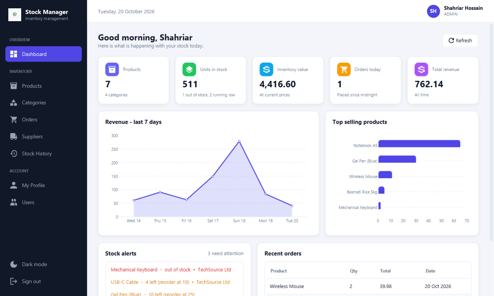
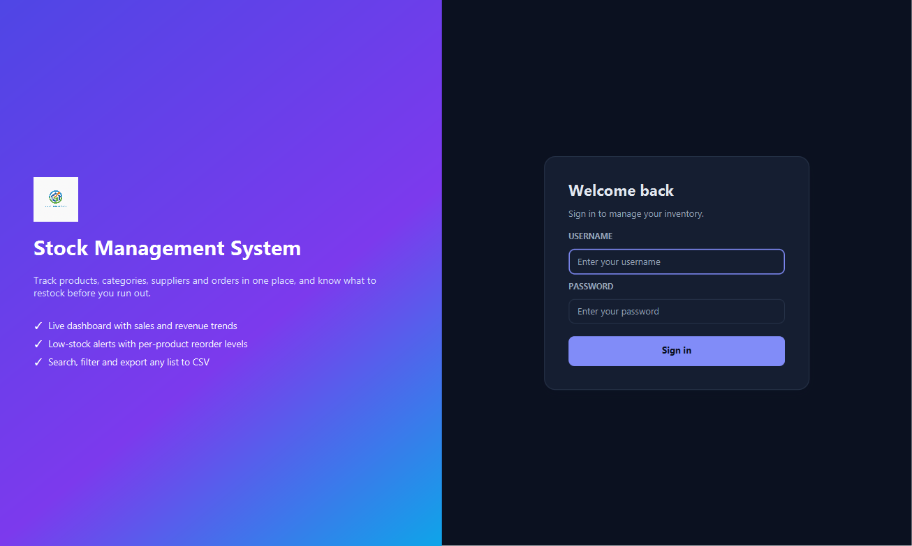
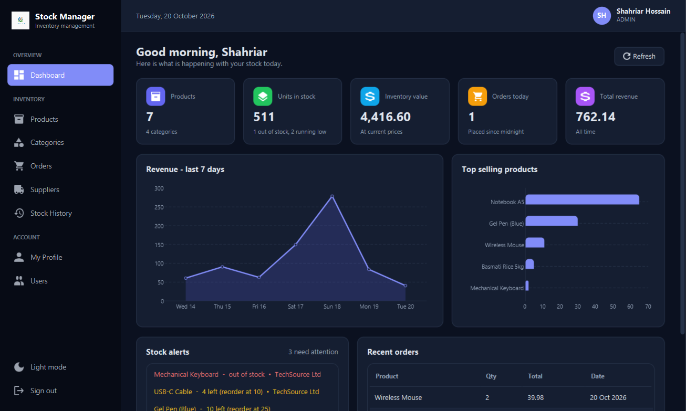
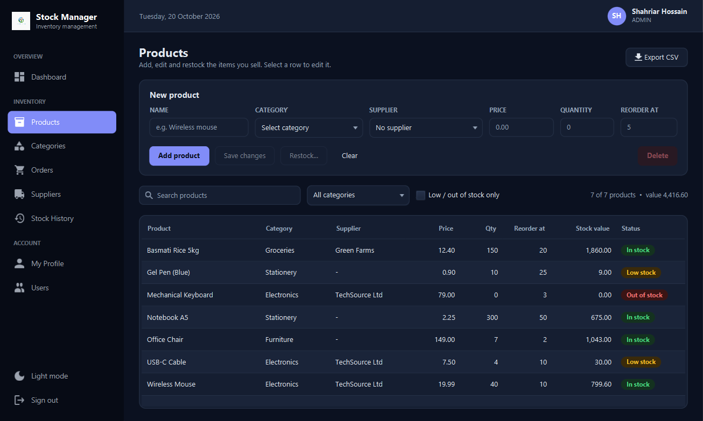
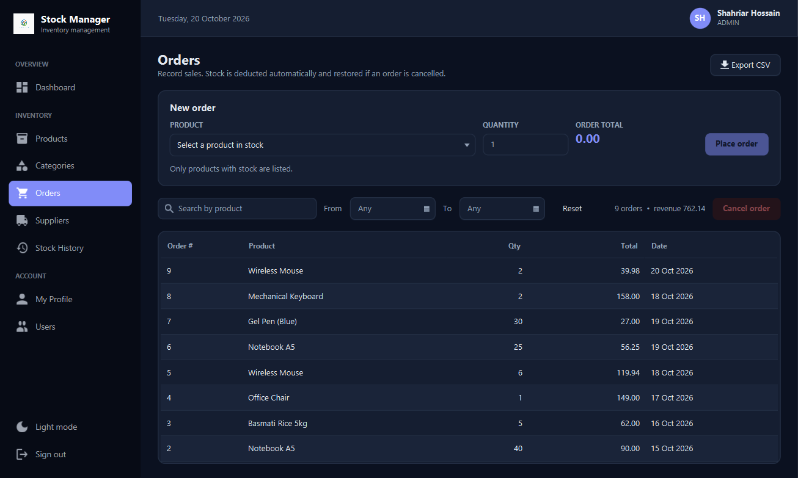
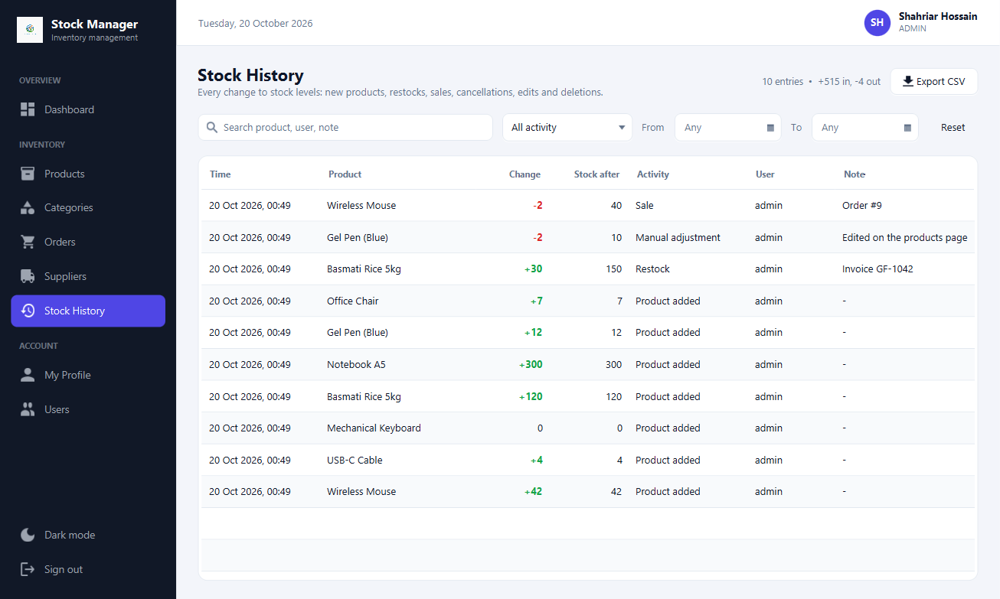
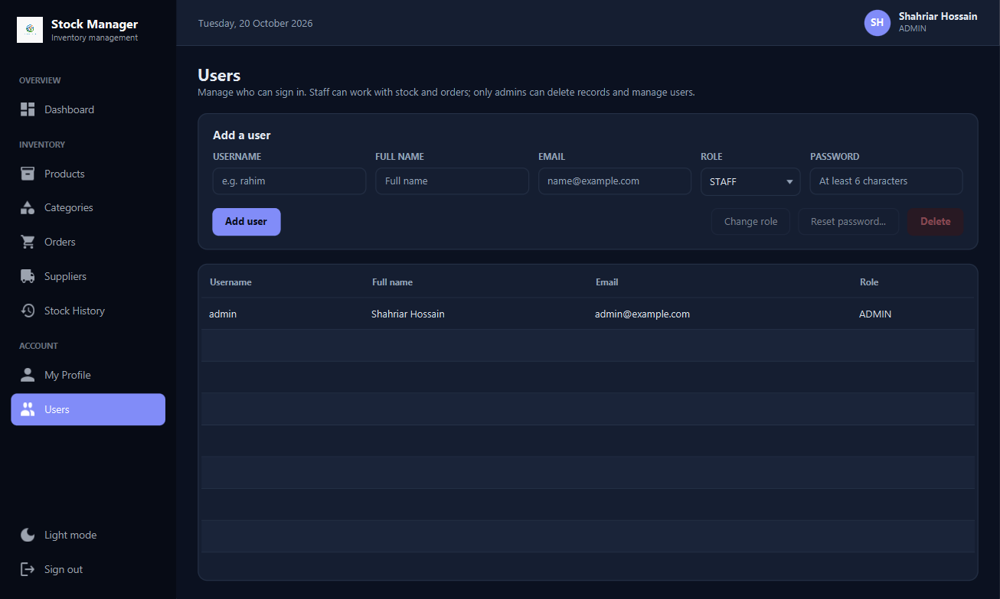

# Stock Management System

A desktop inventory manager built with **JavaFX** and **SQLite**. Track products, categories, suppliers and orders. See sales and revenue on a live dashboard, get low-stock alerts, and keep a full history of every stock change. Your data stays on your own computer in a single database file.



---

## Contents

- [Features](#features)
- [Screenshots](#screenshots)
- [Requirements](#requirements)
- [Getting started](#getting-started)
- [First sign-in](#first-sign-in)
- [Using the app](#using-the-app)
- [Users and roles](#users-and-roles)
- [Backup and restore](#backup-and-restore)
- [Keyboard shortcuts](#keyboard-shortcuts)
- [Where your data is stored](#where-your-data-is-stored)
- [Project structure](#project-structure)
- [Database schema](#database-schema)
- [Troubleshooting](#troubleshooting)

---

## Features

**Dashboard**
- KPI tiles: number of products, units in stock, inventory value, orders today and total revenue
- Revenue chart for the last 7 days
- Top 5 best-selling products
- Stock alerts: products that are out of stock or at/below their reorder level, with the supplier to reorder from
- Most recent orders

**Products**
- Add, edit and delete products with category, supplier, price, quantity and a **reorder level** per product
- **Restock** button to record incoming stock
- Status badges: *In stock*, *Low stock*, *Out of stock*
- Live search, category filter and a "low / out of stock only" filter
- Stock value per product and for the filtered list
- Duplicate product names are rejected

**Orders**
- Place an order. The total is calculated as you type, and stock is deducted automatically.
- Orders that exceed available stock are blocked
- **Cancel an order** to return its quantity to stock
- Search by product and filter by date range, with a running revenue total

**Categories**
- Add, rename and delete categories
- Renaming a category updates every product in it
- Categories that still contain products can't be deleted

**Suppliers**
- Add, edit and delete suppliers, and see how many products each one supplies
- Deleting a supplier unlinks it from its products (the products are kept)

**Stock history**
- An audit trail of every stock change: product added, restock, sale, order cancelled, manual adjustment and product deleted
- Each entry records the time, the change (+/-), the stock level afterwards, the user who did it and a note (for example the order number)
- Filter by activity type, date range or free text

**Accounts and security**
- First-run setup creates the initial administrator account
- **Admin** and **Staff** roles (see [Users and roles](#users-and-roles))
- Edit your name and email; changing your password requires your current password
- Passwords are stored as SHA-256 hashes, never as plain text

**Everywhere**
- Light and dark themes (your choice is remembered)
- **Export to CSV** for products, orders, suppliers and stock history. The export contains exactly the rows currently shown, so filter first to export a subset.
- Sortable tables (click a column header)
- **Backup and restore** of the whole database
- Keyboard shortcuts

---

## Screenshots

| Sign in | Dashboard (dark) |
|---|---|
|  |  |

| Products | Orders |
|---|---|
|  |  |

| Stock history | Users |
|---|---|
|  |  |

---

## Requirements

| Tool | Version | Notes |
|---|---|---|
| JDK | **25** | The build targets Java 25 (`<release>25</release>` in `pom.xml`). |
| Maven | not required | The project includes the Maven Wrapper (`mvnw` / `mvnw.cmd`). |
| JavaFX | 21.0.6 | Downloaded automatically by Maven. |
| SQLite JDBC | 3.46.0.0 | Downloaded automatically by Maven. |

If you use IntelliJ IDEA, it can download JDK 25 for you: **File → Project Structure → SDK → Download JDK**.

---

## Getting started

### 1. Clone the repository

```bash
git clone https://github.com/Shahriar1290/Stock_Management_System.git
cd Stock_Management_System
```

### 2. Point `JAVA_HOME` at JDK 25

The Maven Wrapper needs `JAVA_HOME`. Replace the path with wherever your JDK 25 is installed (IntelliJ puts downloaded JDKs in `~/.jdks`).

**Windows (PowerShell), current window only:**
```powershell
$env:JAVA_HOME = "$env:USERPROFILE\.jdks\openjdk-25"
```

**Windows, permanently** (open a new terminal afterwards):
```powershell
setx JAVA_HOME "$env:USERPROFILE\.jdks\openjdk-25"
```

**macOS / Linux:**
```bash
export JAVA_HOME=/path/to/jdk-25
```

### 3. Run

**Windows:**
```powershell
./mvnw clean javafx:run
```

**macOS / Linux:**
```bash
./mvnw clean javafx:run
```

### Running from IntelliJ IDEA

Open the project folder, set the project SDK to **25**, then either:
- run `MainApp` (`src/main/java/com/example/stock_management_system/MainApp.java`), or
- open the **Maven** tool window and run **Plugins → javafx → javafx:run**.

---

## First sign-in

- **No users yet (new database):** the sign-in screen switches to **Create your admin account**. Enter your name, email, a username and a password (at least 6 characters). This first account is an Admin.
- **Existing database:** sign in with your existing username and password.

**Locked out?** Passwords are stored only as hashes, so they can't be recovered. An admin can reset any password from the **Users** page. If no admin can sign in, open the database in any SQLite tool (for example IntelliJ's Database panel) and run `DELETE FROM users;`. The app then shows the first-run screen again. Products, orders and all other data are kept.

---

## Using the app

### Products
1. Create at least one **category** first (Categories page). Adding a **supplier** is optional.
2. On **Products**, fill in name, category, supplier, price, quantity and *Reorder at*, then click **Add product**.
3. Click a row to edit it. Change fields and click **Save changes**. A changed quantity is logged as a *Manual adjustment*.
4. With a row selected, click **Restock…** to add received units. This is logged as a *Restock*.
5. A product shows **Low stock** when its quantity is at or below its reorder level, and **Out of stock** at 0.

### Orders
1. Choose a product (only products with stock are listed) and enter a quantity.
2. The order total updates as you type. If there isn't enough stock, the button is disabled.
3. Click **Place order**. Stock is deducted and the sale is logged.
4. To undo an order, select it and click **Cancel order** (admins only). The quantity goes back into stock.

### Stock history
Every stock change appears here automatically, newest first. Use the activity filter (for example *Restock* or *Sale*), the date range and the search box, then **Export CSV** for reports.

### Exporting
Click **Export CSV** on Products, Orders, Suppliers or Stock History. The file contains the columns and rows currently shown, so apply filters first if you only want part of the data.

---

## Users and roles

| Action | Admin | Staff |
|---|:---:|:---:|
| View dashboard, products, orders, suppliers, history | ✓ | ✓ |
| Add / edit products, restock, place orders | ✓ | ✓ |
| Add / rename categories, add / edit suppliers | ✓ | ✓ |
| Delete products, categories or suppliers | ✓ | |
| Cancel orders | ✓ | |
| Manage users (Users page) | ✓ | |
| Backup and restore | ✓ | |

Admins manage accounts on the **Users** page: add users, switch a user between Admin and Staff, reset passwords and delete accounts. To prevent lock-outs, you can't change your own role or delete your own account, and the last remaining admin can't be deleted.

---

## Backup and restore

Admins can find this on **My Profile → Backup and restore**.

- **Back up now…** saves a complete, consistent copy of the database (products, orders, categories, suppliers, users and history) to a `.db` file you choose. The suggested name is `stock-backup-YYYY-MM-DD.db`.
- **Restore from backup…** replaces **all** current data with the chosen backup and then signs you out. The file is checked first, and anything that isn't a backup from this app is rejected. Backups made by older versions are upgraded automatically.

> Restoring discards everything changed since that backup was made. Make a fresh backup first if you might need the current data.

---

## Keyboard shortcuts

| Shortcut | Action |
|---|---|
| `Ctrl` + `1` … `8` | Go to the pages in sidebar order (Dashboard, Products, Categories, Orders, Suppliers, Stock History, My Profile, Users) |
| `Ctrl` + `F` | Jump to the search box on the current page |
| `Enter` | Sign in on the login screen; place an order on the Orders page |

On macOS use `Cmd` instead of `Ctrl`.

---

## Where your data is stored

All data is kept in one SQLite file:

| OS | Default location |
|---|---|
| Windows | `C:\Users\<you>\products.db` |
| macOS / Linux | `~/products.db` |

The exact path is shown on **My Profile** (admins). To use a different file, start the app with the `stock.db.path` system property, for example:

```bash
java -Dstock.db.path=/path/to/other.db ...
```

The schema is created on first launch. Databases from older versions of the app are upgraded automatically: missing columns are added and existing data is kept.

The light/dark theme choice is saved in Java user preferences.

---

## Project structure

```
src/main/java/
├── module-info.java
└── com/example/stock_management_system/
    ├── MainApp.java                 # Application entry point
    ├── Navigator.java               # Loads views, switches screens, applies the theme
    ├── Session.java                 # The signed-in user (observable)
    ├── DatabaseManager.java         # All SQL: schema, migrations, queries, transactions, backup
    ├── PasswordUtil.java            # Password hashing
    ├── Dialogs.java                 # Themed alerts, confirmations and prompts
    ├── Formats.java                 # Number/date formatting and table cell helpers
    ├── CsvExporter.java             # Exports the visible rows of any table to CSV
    ├── LoginController.java         # Sign-in and first-run admin setup
    ├── MainLayoutController.java    # Sidebar, top bar, page switching, shortcuts
    ├── DashboardController.java
    ├── ProductsController.java
    ├── CategoriesController.java
    ├── OrderController.java
    ├── SupplierController.java
    ├── StockHistoryController.java
    ├── UsersController.java
    ├── ProfileController.java       # Profile, password change, backup/restore
    └── models/                      # Records: Product, Category, Order, Supplier, User, StockMovement

src/main/resources/
├── com/example/stock_management_system/
│   ├── *.fxml                       # One view per screen, plus MainLayout.fxml (the app shell)
│   └── styles/app.css               # Theme: colours, components, light and dark modes, icons
└── images/Logo.png
```

**How it fits together**
- `MainApp` starts `Navigator`, which shows `LoginPage.fxml`. After sign-in it shows `MainLayout.fxml`, the shell that loads each page into its content area.
- Controllers talk to the single `DatabaseManager.getInstance()`. Each call opens a short-lived SQLite connection. Multi-step changes, such as placing an order, deducting stock and logging the movement, run in one transaction, so they either all succeed or none do.
- The theme is one stylesheet that uses CSS variables. Dark mode adds a `dark` style class to the root, which redefines those colours.

---

## Database schema

| Table | Columns |
|---|---|
| `products` | `id`, `product_name`, `category`, `price`, `quantity`, `reorder_level`, `supplier_id` |
| `categories` | `id`, `name` (unique) |
| `orders` | `id`, `product_name`, `quantity`, `total_price`, `order_date` |
| `suppliers` | `id`, `name`, `contact` |
| `users` | `id`, `username` (unique), `name`, `email`, `role` (`ADMIN` / `STAFF`), `password` (SHA-256, Base64) |
| `stock_movements` | `id`, `product_id`, `product_name`, `change`, `quantity_after`, `reason`, `note`, `username`, `created_at` |

---

## Troubleshooting

**`JAVA_HOME not found in your environment`**
Set `JAVA_HOME` to a JDK 25 installation, as described in [Getting started](#2-point-java_home-at-jdk-25).

**`release version 25 not supported` / `invalid target release: 25`**
`JAVA_HOME` points at an older JDK. Switch it to JDK 25.

**`No suitable driver found for jdbc:sqlite`**
The SQLite driver isn't on the classpath. Run the app through Maven (`./mvnw javafx:run`) or IntelliJ, which add the dependencies for you.

**`SLF4J: Failed to load class "org.slf4j.impl.StaticLoggerBinder"`**
Harmless. The SQLite driver logs nothing unless a logging library is added.

**I forgot my password**
See [First sign-in](#first-sign-in).
